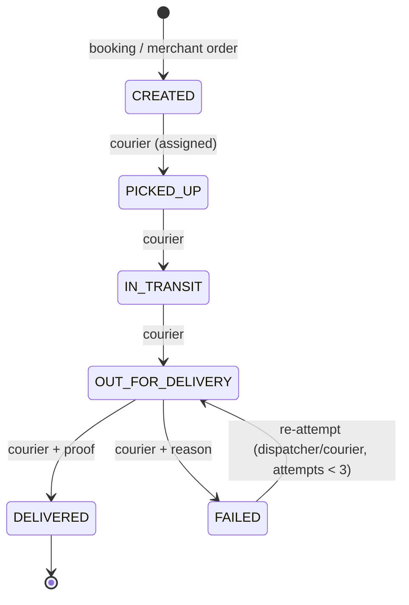

# Parcel lifecycle (contract)

Owner: M4. Code: `packages/contracts/src/parcel-status.ts` (`PARCEL_TRANSITIONS`, `canTransition`).
**Draft: confirm by day 2 of Week 1, frozen after Week 2.**

| Status           | Meaning                    | Who may set it                                             | Required data                                      |
| ---------------- | -------------------------- | ---------------------------------------------------------- | -------------------------------------------------- |
| CREATED          | booking accepted           | system on create                                           | —                                                  |
| PICKED_UP        | courier collected it       | the assigned courier                                       | —                                                  |
| IN_TRANSIT       | moving through the network | the assigned courier                                       | —                                                  |
| OUT_FOR_DELIVERY | final-leg attempt underway | the assigned courier (dispatcher/admin for a re-attempt)   | increments `deliveryAttempts`                      |
| DELIVERED        | done (terminal)            | the assigned courier via `POST /courier/parcels/:id/proof` | ProofOfDelivery (recipient name + photo)           |
| FAILED           | attempt failed             | the assigned courier                                       | `failureReason` ∈ `FAILURE_REASONS`, optional note |

## Rules (enforced in `ParcelsService.transition`, M4)

1. `canTransition(from, to)` must be true. Otherwise throw 409 `INVALID_STATUS_TRANSITION` with
   `details { from, to }`.
2. FAILED without a reason → 422 `FAILURE_REASON_REQUIRED`. DELIVERED without proof → 422
   `PROOF_REQUIRED`.
3. FAILED → OUT_FOR_DELIVERY when `deliveryAttempts >= MAX_DELIVERY_ATTEMPTS` (3) → 409
   `MAX_ATTEMPTS_REACHED`.
4. Every transition does the following in **one transaction**:
   - update `parcels.status` (and `deliveredAt` when DELIVERED);
   - insert a `parcel_status_history` row (from, to, actorId, actorRole, reason, note);
   - `outbox.enqueue('parcel.status_changed', …)`.
5. Callers check _who_ may act (assignment, role) **before** calling `transition`. `transition`
   checks _what_ is allowed.
6. Concurrency: update with `where: { id, status: from }`. If no row matches, someone else changed
   the parcel first; throw 409.

## Tracking numbers

The format is `SD` followed by 9 digits (`SD123456789`), random and unique, retried on collision.
Tracking numbers are public identifiers; the internal `id` (cuid) is never shown on public pages.
